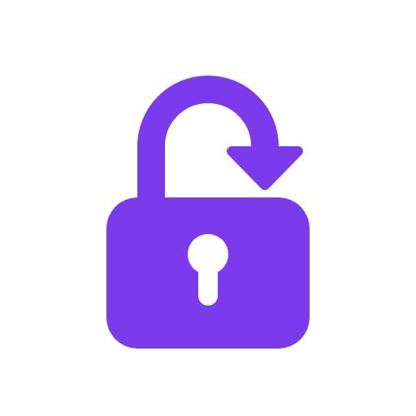
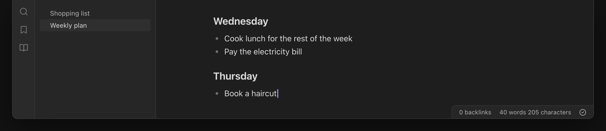

  

<h1 align="center">Sync Gate</h1>

An Obsidian plugin that blocks note editing until Obsidian Sync has brought in the changes from your other devices.

  
  
  
  

Sync Gate blocks editing of notes while Obsidian Sync still brings in changes from your other devices. A quick edit on your phone then cannot conflict with newer text from your laptop.

> **Status: early development.** The lock rules, the Sync status reader and the editor lock are in place. Test the plugin on your devices before you rely on it.

## Screenshots

The images are illustrations of the plugin UI in the default dark theme, with a made-up demo vault. The image at the top shows a locked note on desktop: the lock card covers the note, and the status bar shows "Locked".

When editing is open, the status bar shows only a check mark icon.

On a phone, the status icon in the note header shows the gate state: editing open, locked, or offline with the offline banner.

## Why

Obsidian Sync needs a few seconds to pull in changes after the app opens or comes back from the background. If you type during that time, Sync must merge two versions of the same note. The merge can duplicate or lose text. Sync Gate makes you wait until Sync confirms that your vault is up to date.

## How it works

Sync Gate reads the state of the core Sync plugin and its activity log. It locks the editor when a rule below applies. "Edit anyway" always ends the current lock.

| Rule | When                                                | What Sync Gate does                                                                                                         |
| ---- | --------------------------------------------------- | --------------------------------------------------------------------------------------------------------------------------- |
| R1   | The app opens, or a phone or tablet app comes back from the background | Locks all notes. Unlocks on a new "Fully synced": Sync must show another state first, or log a new "Fully synced" entry. |
| R2   | A change from another device arrives for an open note | Locks only that note until the download ends.                                                                             |
| R3   | A change arrives for a different note               | Does not lock.                                                                                                              |
| R4   | This device uploads a change                        | Does not lock.                                                                                                              |
| R5   | The device is offline                               | Does not lock. Shows an offline banner. See [Offline](#offline).                                                            |
| R6   | The network comes back                              | Locks all notes, as in R1.                                                                                                  |
| R7   | Sync shows no progress for 20 seconds               | Makes "Edit anyway" prominent.                                                                                              |

A lock also ends when Sync stays "Fully synced" with no activity for 15 seconds. Sync does not always start a new round after the app opens, and this rule prevents a lock that never ends.

On a phone or tablet, a short loss of focus, for example the notification shade or a system dialog, is not a resume. Only a return from the background, or a loss of focus for 3 seconds or more, locks.

When you pause Sync, Sync Gate does not lock. It shows a banner, because changes from other devices do not arrive while Sync is paused. When Sync runs again, Sync Gate locks all notes, as in R6. If you select **Edit anyway** while Sync is paused, this lock does not occur. When Sync reports an error, the lock stays on. Wait for Sync, or select **Edit anyway**. An error while Sync has no server connection counts as offline. See [Offline](#offline).

If Sync Gate cannot read the Sync state, for example after an app update changes the internal API, it does not lock. It shows a warning banner instead. A lock that starts in that time, for example at app start, waits and starts when Sync Gate can read the Sync state again.

### Offline

- When the device has no network, Sync Gate ends a lock at once and shows an offline banner. You can edit. Sync merges your changes when the network comes back.
- When the device has a network but Sync has no server connection, the lock stays on for 10 seconds while Sync connects. Phones often drop the server connection while the app is in the background, so Sync reports "disconnected" for a moment after the app comes back. If Sync does not connect in 10 seconds, the lock ends and the offline banner shows.
- When the network or the Sync connection comes back, Sync Gate locks all notes again (R6).

## What you see

- **Lock card.** A locked note switches to Reading view. A dimmed layer covers the note, with a small card in the center: "Waiting for Sync" for an all-notes lock, or "Updating from another device" for a one-note lock. The card has an **Edit anyway** button. When Sync is slow, the card says "Sync is taking longer than usual" and the button becomes prominent. When the lock ends, the note goes back to the mode it had before.
- **Banner.** When Sync Gate does not lock because the device is offline, Sync is paused or the Sync state is unavailable, a one-line notice shows at the top of the note.
- **State indicator on desktop.** An item in the status bar shows the gate state: an icon only when editing is open, and a label for "Locked", "Offline", "Paused" or "Unavailable". Select it to see the state and the reason.
- **Status icon on mobile.** Phones and tablets have no status bar. A status icon always shows in the note header, next to the other note actions. Its color tells the gate state:

  | State                   | Icon                    | Color            |
  | ----------------------- | ----------------------- | ---------------- |
  | Editing open            | Check mark              | Muted text color |
  | Locked                  | Lock                    | Accent color     |
  | Offline or Sync paused  | No Wi-Fi, or pause      | Warning color    |
  | Sync status unavailable | Warning triangle        | Error color      |

  Tap the icon to see the state and the reason. When the icon changes, it stays in the same position, so the other header icons do not move. To show the icon only while editing is blocked, offline or paused, turn off **Show status icon on mobile when editing is open**.

All elements use the colors, fonts and icons of your theme.

## Commands

| Command                               | What it does                                                                                     |
| ------------------------------------- | ------------------------------------------------------------------------------------------------ |
| Show gate status                      | Shows the current gate state and the reason for it.                                              |
| Unlock editing until next sync check  | Ends the current lock, the same as **Edit anyway**. The next startup, resume, reconnect or incoming change locks again. |
| Save diagnostic log                   | Only when **Debug logging** is on. Saves the last 500 gate inputs and decisions as a note in the folder `Sync Gate diagnostics`. The log holds states and member names only, no note names or note text. |

## Requirements

- Obsidian 1.5.0 or later.
- Desktop (Windows, macOS, Linux) or mobile (iOS, Android).
- Obsidian Sync turned on for the vault. Without Sync, Sync Gate does not lock and shows a warning banner.

## Install

### With BRAT

1. Install the [BRAT](https://github.com/TfTHacker/obsidian42-brat) community plugin.
2. In BRAT, select **Add beta plugin**.
3. Enter `joboyx/obsidian-sync-gate`.
4. Turn on **Sync Gate** in **Settings → Community plugins**.

### Manually

1. Download `main.js`, `manifest.json` and `styles.css` from the latest [release](https://github.com/joboyx/obsidian-sync-gate/releases).
2. Create the folder `<your vault>/.obsidian/plugins/sync-gate/`.
3. Copy the three files into that folder.
4. Restart the app and turn on **Sync Gate** in **Settings → Community plugins**.

Install the plugin on every device that edits the vault.

## Settings

| Setting                       | Default   | Description                                                                 |
| ----------------------------- | --------- | --------------------------------------------------------------------------- |
| Protected notes               | All notes | Lock every note, or only one note that you edit on more than one device.    |
| Note path                     | (empty)   | Vault-relative path of the protected note, when you protect one note only. When you rename or move the note, the path changes with it. |
| Lock on resume on mobile only | On        | When on, only phones and tablets lock when the app comes back from the background. Desktop Sync keeps running in the background, so desktop locks at startup, on reconnect and for incoming changes to the open note. |
| Slow sync after (seconds)     | 20        | Time without Sync progress before "Edit anyway" becomes prominent.          |
| Unlock when sync is quiet (seconds) | 15  | Time that Sync must stay up to date, with no activity, before a lock ends on its own. |
| Wait for connection (seconds) | 10        | Time that a lock waits for the Sync server while the network is up. After this time, editing opens with the offline banner. |
| Show status icon on mobile when editing is open | On | When on, the status icon in the note header shows at all times on phones and tablets. When off, it shows only while editing is blocked, offline or paused. |
| Debug logging                 | Off       | Writes lock decisions to the developer console and turns on the **Save diagnostic log** command. |

All times must be whole numbers greater than 0.

## Limitations

- **Undocumented API.** Sync Gate reads internal members of the core Sync plugin. An app update can change them. Sync Gate then stops locking and shows a warning.
- **This device only.** Sync Gate knows only what Sync on this device reports. It cannot know that another device has changes that it did not upload yet.
- **Editor only.** Sync Gate cannot block writes from other plugins, the share sheet or other apps that change files in the vault.
- **Offline editing is allowed.** When the device is offline, Sync Gate does not lock. Sync merges your offline edits when the network comes back.

## Contributing

See [CONTRIBUTING.md](CONTRIBUTING.md). To report a security problem, see [SECURITY.md](SECURITY.md). Coding agents start at [AGENTS.md](AGENTS.md).

## Credits

The Sync status mapping is adapted from [sync-reminder](https://github.com/HEIXIZHU/sync-reminder) by HEIXIZHU (MIT License). See [THIRD_PARTY_NOTICES.md](THIRD_PARTY_NOTICES.md).

## License

MIT. See [LICENSE](LICENSE).
